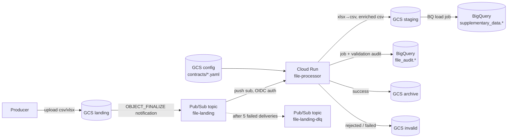

# File Processor PoC — GCS → BigQuery via Cloud Run

## 1. Overview

When a file lands in the GCS **landing** bucket, a Pub/Sub notification triggers a Cloud Run service (Python / FastAPI). The service:

1. Maps the file name to a **data contract** (which gives the target table, schema and rules).
2. Registers a job in `file_audit.job_metadata`.
3. Validates the file against the contract and records every rule result in `file_audit.validation_metadata`.
4. **All-or-nothing:** if every ERROR-severity rule passes, it loads the whole file into the mapped BigQuery table and archives the file. If any ERROR rule fails, it loads nothing and moves the file to the **invalid** bucket.



### Key design decisions

| Topic | Decision | Why |
|---|---|---|
| Runtime | Cloud Run service with **FastAPI** (Python 3.12) | Pydantic models for the Pub/Sub envelope, easy local testing, `/healthz`. Endpoints are sync `def` because the GCP client libraries are blocking. |
| Trigger | GCS notification → Pub/Sub **push** subscription → Cloud Run | Retries with backoff, DLQ, and OIDC-authenticated push. |
| Region | **europe-west2** for every resource, BigQuery datasets included | All of your existing resources are in this region. |
| Bad data | **All-or-nothing** | Any ERROR rule failure rejects the whole file. Partial loads never happen. WARNING rules are only recorded. |
| Networking | **No VPC/subnet** | Cloud Run reaches GCS, BigQuery and Pub/Sub through Google APIs. Security comes from internal ingress plus authenticated push. If a private resource is ever needed, add Direct VPC egress then. |
| Contracts | YAML in a GCS **config** bucket, **published by DataDesk** | Mappings and rules can change without redeploying. DataDesk's onboarding contract is the source: it writes `contracts/<dataset>.<table>.yaml` whenever the contract changes (see §3). Terraform only creates the bucket. The service caches each table's contract; a change in the bucket notifies topic `contract-changes`, whose push calls `POST /contracts` to read it again (see §2). |
| File size | Small (< ~100 MB) | Rows are validated by streaming through Python, then loaded with a **BQ load job** from GCS. Streaming inserts are not used. |
| Deployment | `gcloud run deploy --source` from local. **No Terraform-managed registry.** | Terraform creates the Cloud Run service with a placeholder image and ignores later image changes. Code deploys come from local. Cloud Build builds the image and gcloud creates the `cloud-run-source-deploy` Artifact Registry repo itself. |
| Audit writes | `job_metadata` uses DML INSERT/UPDATE. `validation_metadata` uses `insert_rows_json` | Rows in the streaming buffer can't be UPDATEd. Validation rows are insert-only, so streaming is fine for them. |

---

## 2. Processing flow (Cloud Run service)

`POST /pubsub` receives the Pub/Sub push envelope.

| # | Step | Outcome |
|---|---|---|
| 1 | Parse the envelope. Ignore events other than `OBJECT_FINALIZE` and folder placeholders (`name` ending with `/`). | 204, ack |
| 2 | **Resolve the contract.** A file under a table folder (`…/<dataset>.<table>/…`, which is how DataDesk lands files) reads only `contracts/<dataset>.<table>.yaml`, on demand, cached per table. The cache is refreshed by `POST /contracts` when the YAML changes, a file tagged with another `contract_version` (DataDesk tags every file) reads it again at once, and every entry expires after `CONTRACT_CACHE_TTL_SECONDS`. A file without one is matched by name against every contract's `file_pattern`. The pattern's date group gives `file_date`. | No contract → move the file to `invalid/_unmapped/...`, job `REJECTED`, ack |
| 3 | **Idempotency check.** Key = `bucket/name#generation` (guards against Pub/Sub redelivering the same message). If a job with this key already has status `SUCCESS` or `IN_PROGRESS`, skip and ack. Otherwise `attempt_number` = prior attempts + 1. A new upload of the same file gets a new generation and is processed normally. `load_mode: append` adds the rows again; `overwrite` replaces the table. | `DUPLICATE_SKIPPED`, ack |
| 4 | **Register the job** in `job_metadata` (DML INSERT, status `IN_PROGRESS`). | |
| 5 | **Convert `.xlsx`** to CSV in the staging bucket (first sheet, using openpyxl). | |
| 6 | **File-level checks:** not empty, UTF-8, header matches the contract columns, min/max row count. | |
| 7 | **Row-level checks:** `not_null`, type (`INT64`, `NUMERIC`, `FLOAT64`, `DATE`, `TIMESTAMP`, `BOOL`), `regex`, `allowed_values`, `max_length`, unique key within the file. Each rule records its counts and up to 10 sample failures (row number and value). | |
| 8 | Write one `validation_metadata` row per rule executed. | |
| 9 | If any ERROR rule failed, move the original file to the invalid bucket at `<contract>/<yyyy>/<mm>/<dd>/<job_id>/<file>`. The job_id folder means a file received again never overwrites an earlier copy. | job `REJECTED`, ack |
| 10 | Write an **enriched CSV** to staging with `_job_id`, `_source_file` and `_loaded_at` added. Run a **BQ load job** (the contract's `load_mode` sets this: `append` → `WRITE_APPEND`, `overwrite` → `WRITE_TRUNCATE`) and wait for it. | |
| 11 | **Post-load reconciliation:** compare rows in the file with the load job's `output_rows` and record the result as a `POST_LOAD` validation row. | |
| 12 | Move the original file to the archive bucket at `<contract>/<yyyy>/<mm>/<dd>/<job_id>/<file>`, and delete the staging temp files. | job `SUCCESS`, ack |

**Error handling**

- **Transient** errors (GCP 5xx, timeouts, rate limits): set the job to `FAILED` and return **500**. Pub/Sub then retries with exponential backoff. After 5 attempts the message goes to the DLQ.
- **Permanent** errors (unexpected parse error, bad contract): move the file to invalid, set the job to `FAILED`, and return **200** so the message isn't retried.
- **In progress elsewhere:** if another attempt for the same object generation is `IN_PROGRESS` and started less than 11 minutes ago, return **409**. Pub/Sub retries later. An older `IN_PROGRESS` row is treated as a crashed attempt and processing starts again.
- **After the load succeeds, the message is always acked (200).** Rows are already in BigQuery, so a retry would load them twice. If the archive move fails, the job is still `SUCCESS` with `status_reason` "archive move failed, file left in landing", and the file has to be moved by hand.
- **Recon mismatch** (rows loaded ≠ rows in file; shouldn't happen with `max_bad_records=0`): job `FAILED`, `error_code = RECON_MISMATCH`. The rows stay loaded and can be found by `_job_id`.
- **Malformed Pub/Sub message:** **400**. Pub/Sub retries it, then sends it to the DLQ.
- **Failure before the job row exists** (e.g. BigQuery unavailable): **500**, retry.

**Job status values:** `IN_PROGRESS`, `SUCCESS`, `REJECTED`, `FAILED`, `DUPLICATE_SKIPPED`

**File moves** are a GCS copy (rewrite) followed by a delete of the source. The delete only goes ahead if the object generation still matches, so a newer upload with the same name isn't touched.

---

## 3. Data contract format (`contracts/<dataset>.<table>.yaml` in the config bucket)

DataDesk publishes these from its onboarding contracts (one per BigQuery table with **File
upload (Cloud Run)** turned on), and removes them when the table is paused there. Change the
rules in DataDesk: an edit made in the bucket is overwritten on the next publish. The files in
`config/contracts/` are starter contracts and test fixtures (`make upload-contracts` copies
them to the bucket for a run without DataDesk).

```yaml
name: customer
version: 1
description: Customer master data
file_pattern: '^customer_(\d{8})\.(csv|xlsx)$'   # filename → contract
file_date_group: 1                               # regex group holding YYYYMMDD
target_table: supplementary_data.customer
load_mode: append                                # the default: append | overwrite (see §2 step 3)
load_modes: [append, overwrite]                  # optional: modes a file may ask for (object metadata load_mode)
file_format: [csv, xlsx]
delimiter: ','
has_header: true
min_rows: 1
max_rows: 1000000
unique_key: [customer_id]                        # ERROR if duplicates in the file
columns:
  - { name: customer_id, type: INT64,  required: true }
  - { name: first_name,  type: STRING, required: true, max_length: 100 }
  - { name: last_name,   type: STRING, required: true, max_length: 100 }
  - { name: email,       type: STRING, required: true, regex: '^[^@\s]+@[^@\s]+\.[^@\s]+$' }
  - { name: phone,       type: STRING, required: false, severity: WARNING, regex: '^\+?[0-9\- ]{7,20}$' }
  - { name: country,     type: STRING, required: true, allowed_values: [US, UK, IN, CA, AU] }
  - { name: signup_date, type: DATE,   required: true }
  - { name: is_active,   type: BOOL,   required: true }
```

- Column rules DataDesk adds (all optional): `unique: true` (no value repeats in the file), `min` / `max` (numeric range, rule type `RANGE`), `min_length`, and `description` (a note for people sending files; not checked). They are contract checks like the others, so they roll into the `data_contract` row of `validation_metadata`.
- **Load mode per file:** a landed object may carry custom metadata `load_mode=append|overwrite` (DataDesk sets it from the sender's choice). Cloud Run uses it when the contract's `load_modes` allows it, rejects the file (`LOAD_MODE_NOT_ALLOWED`) when it doesn't, and uses `load_mode` when the object carries none.
- The default severity for every rule is `ERROR`. A column can set `severity: WARNING`, which means failures are recorded but don't block the load.
- Header matching checks the **column names and their order** against `columns`. If the header doesn't match, row-level checks are skipped.
- A table folder in the object path (`datadesk/supplementary_data.customer/<id>/customer_20261015.csv`) picks the contract directly: only that table's YAML is read, so the number of contracts doesn't matter. A contract file must be for the table it is named after.
- Without a table folder, the base name is matched against every contract's `file_pattern` (all contracts are read). A file matching more than one contract is rejected (`AMBIGUOUS_CONTRACT`).
- `DATE`/`TIMESTAMP` columns accept ISO 8601, plus an optional `format` (strptime, e.g. `'%d/%m/%Y'`). Values are normalized to ISO in the loaded data. A timestamp without a timezone is treated as UTC.
- `BOOL` accepts `true/false`, `t/f`, `yes/no`, `y/n` and `1/0`, case-insensitive.
- Blank lines are ignored. A UTF-8 BOM (common in Excel exports) is accepted.
- Excel: only `.xlsx`, and only the first sheet. Excel date cells become ISO dates.
- A value that fails a WARNING-severity **type** check is loaded as NULL.

---

## 4. Audit tables (dataset `file_audit`)

The original schemas came from a BQ → GCS Dataflow/Airflow use case. They are trimmed to fit a GCS → BQ, Cloud Run, file-based load.

### 4.1 `job_metadata`: one row per processing attempt

**Removed (not relevant here):** `orchestrator_type`, `dag_id`, `dataflow_job_id`, `dataflow_worker_count`, `dataflow_machine_type`, `source_type`, `target_type`, `source_description`, `target_description`, `load_type`, `extract_from`, `extract_to`, `watermark_column`, `watermark_value_used`, `watermark_value_new`, `rows_quarantined`, `dedup_status`, `dedup_count`, `dedup_details`, `control_status`, `control_rules_executed`, `control_rules_failed`, `control_details`, `header_value_generated`, `trailer_value_generated`, `generates_trigger_file`, `trigger_file_path`, `has_errors` (derived from `status`), `comments`, `config_path`, `rows_read`, `rows_written`, `source_row_count`, `target_row_count`, `recon_delta`, `recon_method`, `recon_details` and `validation_details` (the details now live in `validation_metadata`).

**Final schema** (partitioned by `DATE(created_at)`, clustered by `status`, `target_table`):

| Column | Type | Mode | Notes |
|---|---|---|---|
| job_id | STRING | REQUIRED | UUID for this attempt |
| job_name | STRING | REQUIRED | `<contract>_load` (or `unmapped`) |
| trigger_type | STRING | NULLABLE | `PUBSUB` / `MANUAL` |
| pubsub_message_id | STRING | NULLABLE | **new** |
| pubsub_subscription | STRING | NULLABLE | **new** |
| delivery_attempt | INTEGER | NULLABLE | **new**, from the Pub/Sub envelope |
| attempt_number | INTEGER | NULLABLE | **new**, attempt count for this object generation |
| is_retried | BOOLEAN | NULLABLE | kept |
| status | STRING | NULLABLE | IN_PROGRESS / SUCCESS / REJECTED / FAILED / DUPLICATE_SKIPPED |
| status_reason | STRING | NULLABLE | **new**, short human reason |
| start_time | TIMESTAMP | NULLABLE | kept |
| end_time | TIMESTAMP | NULLABLE | kept |
| duration_seconds | FLOAT | NULLABLE | kept |
| source_bucket | STRING | NULLABLE | **new** |
| file_name | STRING | NULLABLE | kept |
| file_path | STRING | NULLABLE | kept, `gs://` URI in landing |
| file_generation | STRING | NULLABLE | **new**, part of the idempotency key |
| file_size_bytes | INTEGER | NULLABLE | **new** |
| file_format | STRING | NULLABLE | **new**, `csv` / `xlsx` |
| file_date | DATE | NULLABLE | kept, parsed from the filename |
| file_created_at | TIMESTAMP | NULLABLE | **new**, GCS object `timeCreated` |
| staged_file_path | STRING | NULLABLE | **new**, staging URI used for the load |
| final_file_path | STRING | NULLABLE | **new**, archive or invalid URI |
| contract_name | STRING | NULLABLE | **new** |
| contract_version | STRING | NULLABLE | **new** |
| target_table | STRING | NULLABLE | renamed from `target_name`, `project.dataset.table` |
| load_mode | STRING | NULLABLE | **new**, `append` / `overwrite` from the contract; replaces `load_type` |
| bq_load_job_id | STRING | NULLABLE | **new** |
| rows_in_file | INTEGER | NULLABLE | **new**, data rows excluding the header |
| rows_loaded | INTEGER | NULLABLE | **new**, from load job `output_rows` |
| rows_failed_validation | INTEGER | NULLABLE | **new**, distinct rows failing any ERROR rule |
| validation_status | STRING | NULLABLE | kept, PASSED / FAILED |
| validation_rules_executed | INTEGER | NULLABLE | kept |
| validation_rules_failed | INTEGER | NULLABLE | kept |
| recon_status | STRING | NULLABLE | kept, PASSED / FAILED / SKIPPED |
| error_code | STRING | NULLABLE | **new** |
| error_message | STRING | NULLABLE | **new** |
| error_details | JSON | NULLABLE | kept, type changed to JSON |
| gcp_project | STRING | NULLABLE | kept |
| gcp_region | STRING | NULLABLE | kept |
| service_name | STRING | NULLABLE | **new**, `K_SERVICE` |
| service_revision | STRING | NULLABLE | **new**, `K_REVISION` |
| service_version | STRING | NULLABLE | renamed from `framework_version` |
| created_by | STRING | NULLABLE | kept, service account |
| custom_labels | JSON | NULLABLE | kept |
| created_at | TIMESTAMP | REQUIRED | kept |
| updated_at | TIMESTAMP | NULLABLE | kept |

### 4.2 `validation_metadata`: one row per check per job (insert-only)

Each **check** is one row, not each column rule. Per-column results go in JSON. A typical file writes **3 rows** (the original per-rule design wrote 21):

| check_name | check_type | Rows | What it covers |
|---|---|---|---|
| `data_contract` | `DATA_CONTRACT` | 1 | Every schema/column check in the contract: encoding, header, column count, row count, plus per column not-null, type, regex, allowed values, max length. `details` holds the per-check results; `check_config` holds a snapshot of the contract that was enforced. |
| `<rule name>` (e.g. `unique_key`) | `CUSTOM_RULE` | 1 per rule | Contract-level business rules. New custom rules each get their own row. |
| `recon_row_count` | `RECONCILIATION` | 1 (`POST_LOAD`) | Rows loaded vs rows in file |
| `contract_match` / `file_format` | `CONTRACT_MATCH` / `FILE_FORMAT` | 1 | Only when a file is rejected before validation |

`details` stays small. A passing check is just `{"result": "PASS", "evaluated": n}`. Only failing checks carry `severity`, `expected`, `actual`, `error` and up to 10 `samples` (`{row_number, value}`):

```json
{"file":    {"header_match": {"result": "PASS"}, "column_count": {"result": "PASS", "evaluated": 10}, ...},
 "columns": {"email":   {"not_null": {"result": "PASS", "evaluated": 10},
                         "regex":    {"result": "FAIL", "severity": "ERROR", "evaluated": 10, "failed": 1,
                                      "expected": "^[^@\\s]+@...", "samples": [{"row_number": 2, "value": "not-an-email"}]}},
             "country": {...}}}
```

**Changed from the previous version:** the per-rule columns (`rule_name`, `rule_type`, `column_name`, `expected_value`, `actual_value`, `records_passed`, `failure_percentage`, `error_message`, `sample_failures`, `rule_params`) are replaced by `check_name`, `check_type`, `summary`, `failed_checks`, `details` and `check_config`.

**Final schema** (partitioned by `DATE(created_at)`, clustered by `job_id`, `validation_result`):

| Column | Type | Mode | Notes |
|---|---|---|---|
| validation_id | STRING | REQUIRED | UUID |
| job_id | STRING | REQUIRED | → job_metadata.job_id |
| file_name | STRING | NULLABLE | denormalised for easy querying |
| target_table | STRING | NULLABLE | |
| contract_name | STRING | NULLABLE | |
| contract_version | STRING | NULLABLE | |
| stage | STRING | NULLABLE | `PRE_LOAD` / `POST_LOAD` |
| check_name | STRING | NULLABLE | `data_contract`, `unique_key`, `recon_row_count`, … |
| check_type | STRING | NULLABLE | `DATA_CONTRACT`, `CUSTOM_RULE`, `RECONCILIATION`, `CONTRACT_MATCH`, `FILE_FORMAT` |
| validation_result | STRING | NULLABLE | `PASS`, `WARN` (only WARNING checks failed; file still loads), `FAIL` (file rejected) |
| severity | STRING | NULLABLE | severity of the failure; null on PASS |
| summary | STRING | NULLABLE | one line, e.g. `2 of 19 contract checks failed: email.REGEX (1 row), country.ALLOWED_VALUES (1 row)` |
| records_evaluated | INTEGER | NULLABLE | data rows checked |
| records_failed | INTEGER | NULLABLE | distinct rows failing an ERROR check |
| records_warned | INTEGER | NULLABLE | distinct rows failing a WARNING check |
| checks_evaluated | INTEGER | NULLABLE | individual checks rolled into this row |
| checks_failed | INTEGER | NULLABLE | individual checks that failed |
| failed_checks | STRING | REPEATED | e.g. `["email.REGEX", "HEADER_MATCH"]`; filter with `'email.REGEX' IN UNNEST(failed_checks)` |
| details | JSON | NULLABLE | per-check results (see above) |
| check_config | JSON | NULLABLE | contract snapshot / rule parameters that were enforced |
| validated_at | TIMESTAMP | NULLABLE | |
| created_at | TIMESTAMP | REQUIRED | |

Useful queries:

```sql
-- All failures and warnings today
SELECT file_name, check_name, validation_result, summary, failed_checks
FROM file_audit.validation_metadata
WHERE DATE(created_at) = CURRENT_DATE() AND validation_result != 'PASS';

-- Files that failed a specific check, with its sample values
SELECT file_name, JSON_QUERY(details, '$.columns.email.regex.samples') AS samples
FROM file_audit.validation_metadata
WHERE DATE(created_at) = CURRENT_DATE() AND 'email.REGEX' IN UNNEST(failed_checks);
```

---|---|---|---|
| validation_id | STRING | REQUIRED | UUID |
| job_id | STRING | REQUIRED | → job_metadata.job_id |
| file_name | STRING | NULLABLE | denormalised for easy querying |
| target_table | STRING | NULLABLE | **new** |
| contract_name | STRING | NULLABLE | **new** |
| contract_version | STRING | NULLABLE | **new** |
| stage | STRING | NULLABLE | `FILE_LEVEL` / `ROW_LEVEL` / `POST_LOAD` |
| rule_name | STRING | NULLABLE | e.g. `email_regex` |
| rule_type | STRING | NULLABLE | `CONTRACT_MATCH`, `FILE_FORMAT`, `ENCODING`, `CSV_PARSE`, `HEADER_MATCH`, `ROW_COUNT`, `COLUMN_COUNT`, `NOT_NULL`, `TYPE`, `REGEX`, `ALLOWED_VALUES`, `MAX_LENGTH`, `UNIQUE`, `RECON_ROW_COUNT` |
| column_name | STRING | NULLABLE | null for file-level rules |
| severity | STRING | NULLABLE | `ERROR` / `WARNING` |
| expected_value | STRING | NULLABLE | e.g. expected header, type, row count |
| actual_value | STRING | NULLABLE | |
| records_evaluated | INTEGER | NULLABLE | |
| records_passed | INTEGER | NULLABLE | |
| records_failed | INTEGER | NULLABLE | |
| failure_percentage | FLOAT | NULLABLE | **new** |
| validation_result | STRING | NULLABLE | `PASS` / `FAIL` / `SKIPPED` |
| error_message | STRING | NULLABLE | for when the rule itself errored |
| sample_failures | JSON | NULLABLE | up to 10 `{row_number, value}` entries |
| rule_params | JSON | NULLABLE | rule config snapshot (regex, allowed values…) |
| validated_at | TIMESTAMP | NULLABLE | renamed from `validation_time` |
| created_at | TIMESTAMP | REQUIRED | |

The JSON schema files in `Infra/bq/` will be rewritten to match these tables (Phase 1).

---

## 5. Infrastructure (Terraform, `Infra/terraform/`)

### Resources

| Area | Resource | Details |
|---|---|---|
| APIs | `google_project_service` | run, pubsub, storage, bigquery, iam, plus cloudbuild and artifactregistry (used by `gcloud run deploy --source`) |
| Storage | `landing` bucket | Producers drop files here. A notification is configured on it. |
| | `invalid` bucket | Rejected and failed files |
| | `archive` bucket | Successfully loaded files. Lifecycle moves them to Nearline after 30 days. |
| | `staging` bucket | xlsx→csv conversions and enriched CSVs. Lifecycle deletes objects after 7 days. |
| | **`config` bucket (added)** | Contract YAMLs, published by DataDesk. Terraform doesn't manage the objects (run `make contracts-handover` once if an older state still tracks them) |
| Pub/Sub | topic `file-landing` | |
| | `google_storage_notification` | landing → topic, `OBJECT_FINALIZE`, `JSON_API_V1` |
| | push subscription `file-processor-push` | OIDC token (invoker SA), ack deadline 600 s, exponential backoff 10 s to 600 s, DLQ after 5 attempts |
| | **DLQ topic `file-landing-dlq` + pull sub (added)** | Catches poison messages |
| BigQuery | dataset `supplementary_data` | tables `customer`, `user`, `orders` |
| | **dataset `file_audit` (added)** | `job_metadata`, `validation_metadata` (schemas from `Infra/bq/*.json`) |
| Compute | Cloud Run v2 service `file-processor` | Created with the placeholder image `us-docker.pkg.dev/cloudrun/container/hello`, with `lifecycle { ignore_changes = [image, client, client_version] }` so local deploys aren't reverted. Ingress internal-only, concurrency 4, max instances 5, min 0, timeout 600 s, 1 vCPU / 1 GiB, env vars below |
| IAM | **SA `file-processor-sa` (added)** | objectAdmin on landing/invalid/archive/staging, objectViewer on config, `bigquery.dataEditor` on both datasets, `bigquery.jobUser` on the project |
| | **SA `pubsub-invoker-sa` (added)** | `run.invoker` on the service |
| | GCS service agent | `pubsub.publisher` on `file-landing` |
| | Pub/Sub service agent | `iam.serviceAccountTokenCreator` on the invoker SA, publisher on the DLQ, subscriber on the push sub |
| Network | none | No subnet or VPC needed (see decisions) |

Bucket names follow `<project_id>-<env>-<purpose>`. All buckets use uniform bucket-level access.

### Business tables (`supplementary_data`)

Every table gets three audit columns, `_job_id STRING`, `_source_file STRING` and `_loaded_at TIMESTAMP`, and is partitioned by `DATE(_loaded_at)`.

| Table | Columns |
|---|---|
| `customer` | customer_id INT64, first_name, last_name, email, phone STRING, country STRING, signup_date DATE, is_active BOOL |
| `user` | user_id INT64, username STRING, email STRING, customer_id INT64, role STRING, created_at TIMESTAMP, last_login_at TIMESTAMP |
| `orders` | order_id INT64, customer_id INT64, order_date DATE, amount NUMERIC, currency STRING, status STRING |

### Terraform layout

```
Infra/
  bq/                         # table schemas (JSON)
    job_metadata.json
    validation_metadata.json
    customer.json  user.json  orders.json
  terraform/
    providers.tf  variables.tf  locals.tf  apis.tf  storage.tf  pubsub.tf
    bigquery.tf   iam.tf  cloud_run.tf
    outputs.tf    terraform.tfvars.example
```

- **Variables:** `project_id`, `region` (default `europe-west2`), `env` (default `poc`), `bq_location` (default `europe-west2`).
- **State:** local for the PoC. A `gcs` backend block is included, commented out.
- **Deploy order:**
  1. `terraform apply`: creates all infra, including the Cloud Run service on the placeholder image. This gives the push subscription a URL and the IAM bindings a target.
  2. From `file-processor-service/`, deploy the code:
     ```
     gcloud run deploy file-processor --source . --region <region> \
       --service-account file-processor-sa@<project>.iam.gserviceaccount.com
     ```
     Env vars, ingress and scaling stay as Terraform set them.
  3. Later code changes repeat step 2 only. Terraform ignores the image, so a re-apply won't roll back the deploy.

---

## 6. Cloud Run service (`file-processor-service/`)

**Stack:** Python 3.12, FastAPI, uvicorn, google-cloud-storage, google-cloud-bigquery, pydantic / pydantic-settings, PyYAML, openpyxl, pytest.

```
file-processor-service/
  app/
    main.py            # FastAPI app: POST /pubsub, GET /healthz
    config.py          # Settings from env vars (pydantic-settings)
    models.py          # Pub/Sub envelope, GCS object event, Contract, RuleResult, statuses
    contracts.py       # Contracts per table (cached, refreshed by POST /contracts), filename match
    coercion.py        # Type parsing/normalization (INT64, NUMERIC, DATE, ...)
    converter.py       # xlsx → csv
    validator.py       # file-level + row-level rules → ValidationReport
    checks.py          # roll rule results into validation_metadata rows (data_contract, custom, recon)
    loader.py          # enriched csv + BQ load job
    audit.py           # job_metadata (DML) / validation_metadata (insert_rows_json)
    storage.py         # download, upload, move, delete
    processor.py       # orchestration (steps 1–12), HTTP status mapping
    logging_config.py  # JSON logs, per-request context (job_id, file, trace), step timing
  tests/               # pytest; GCS/BQ replaced by fakes (conftest.py)
  Dockerfile
  requirements.txt  requirements-dev.txt  pyproject.toml (ruff + pytest config)
  README.md
```

**Routes:** `POST /pubsub` (a file landed: push subscription `file-processor-push`), `POST /contracts` (a contract YAML changed in the config bucket: push subscription `contract-refresh-push` on topic `contract-changes`; reads that contract again and returns 204), `GET /healthz`. One Cloud Run service, one route per push subscription. A push reaches one instance; the others catch up through the per-file version check or the TTL.

**Environment variables:** `GCP_PROJECT`, `GCP_REGION`, `LANDING_BUCKET`, `INVALID_BUCKET`, `ARCHIVE_BUCKET`, `STAGING_BUCKET`, `CONFIG_BUCKET`, `CONTRACTS_PREFIX` (default `contracts/`), `AUDIT_DATASET` (default `file_audit`), `CONTRACT_CACHE_TTL_SECONDS` (default `300`), `RUNTIME_SERVICE_ACCOUNT` (written to `created_by`), `SERVICE_VERSION`, `LOG_LEVEL` (default `INFO`).

**Logging:** structured JSON with `job_id`, `file`, `message_id`, `contract` and the Cloud trace on every line. There's one line per step with timings, and every audit table write is logged. See `file-processor-service/README.md` → Logging.

**HTTP response contract with Pub/Sub:** 2xx acks the message (terminal outcomes). 5xx makes Pub/Sub retry (transient errors only).

---

## 7. Contracts and mock data

`config/contracts/`: `customer.yaml`, `user.yaml`, `orders.yaml`: starter contracts and test fixtures. The live ones are published by DataDesk; onboarding a table in DataDesk starts from the contract the bucket already has for it.

`mockdata/` (all files generated by `mockdata/generate.py`, i.e. `make mockdata`; `tests/test_mockdata.py` checks each outcome):

| File | Purpose | Expected result |
|---|---|---|
| `customer_20261015.csv` | 20 valid rows | SUCCESS, archived |
| `user_20261015.csv` | 15 valid rows | SUCCESS, archived |
| `orders_20261015.csv` | 25 valid rows | SUCCESS, archived |
| `customer_20261017.csv` | 5 rows, 2 with a badly formatted phone (WARNING rule) | SUCCESS, warning recorded in validation_metadata |
| `customer_20261016.csv` | bad email, null id, duplicate key, bad country, bad date, bad boolean | REJECTED, invalid bucket |
| `user_20261016.csv` | missing `role` column | REJECTED (HEADER_MATCH) |
| `unknown_20261015.csv` | no matching contract | REJECTED, `invalid/_unmapped/` |
| `customer_id_200.csv` | 3 valid customer rows, name not `customer_YYYYMMDD` | REJECTED when dropped by hand; via DataDesk it lands renamed under its table folder and loads |
| `orders_20261016.xlsx` | 10 rows; tests the Excel conversion path | SUCCESS |

---

## 8. Roadmap

| Phase | Scope |
|---|---|
| **P1** ✅ | `project.md` (this doc). Rewrite `Infra/bq/job_metadata.json` and `validation_metadata.json`. Add business table schemas. |
| **P2** ✅ | Terraform: all resources in §5 (`terraform validate` / `plan`) |
| **P3** ✅ | Service core: settings, models, contracts loader, validator, unit tests |
| **P4** ✅ | Service I/O: storage, converter, loader, audit, processor, FastAPI endpoints, tests with mocked clients |
| **P5** | Contracts YAML, mock data, Dockerfile, `gcloud run deploy --source` from local, end-to-end run |
| **P6** | Hardening: alerting on DLQ depth and FAILED/REJECTED jobs, audit reporting views, optional GCS state backend, CI |

---

## 9. Verification

- **Unit:** `pytest` in `file-processor-service/` covers validator rules, contract matching and processor branches (success, rejected, unmapped, duplicate, transient error) with mocked GCS/BQ clients.
- **Local:** run the service with `uvicorn` against the real dev buckets and datasets, then post a Pub/Sub envelope with `curl` (see `file-processor-service/README.md`).
- **Infra:** `terraform fmt -check`, `terraform validate`, `terraform plan`.
- **End-to-end:**
  1. `gcloud storage cp mockdata/*.csv mockdata/*.xlsx gs://<project>-poc-landing/`
  2. Query `file_audit.job_metadata` and check the expected status per file (§7).
  3. Query `file_audit.validation_metadata` for the rejected jobs and confirm the failing rules and samples.
  4. Check that the files are in the archive or invalid bucket and that the landing bucket is empty.
  5. Run `SELECT COUNT(*)` on `supplementary_data.*` and check it matches the row counts in the files.
  6. Re-upload an append-mode file → its rows are added again. Re-upload an overwrite-mode file → the table is replaced and the row count stays the same.
